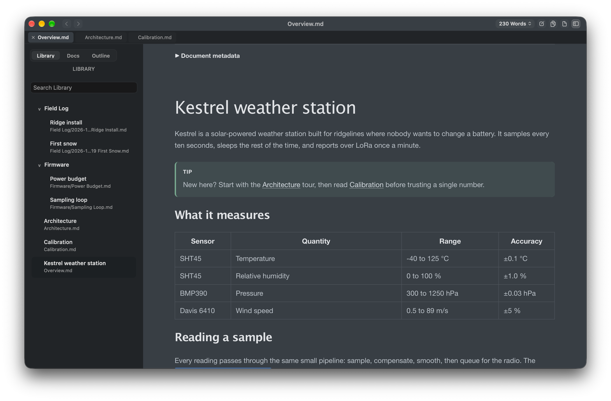
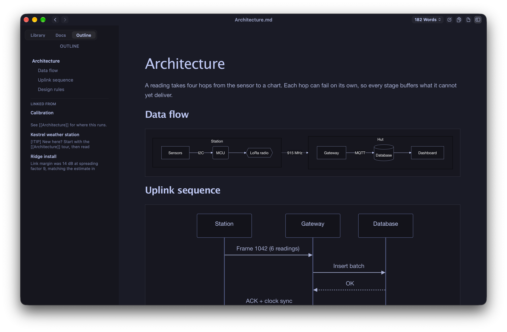
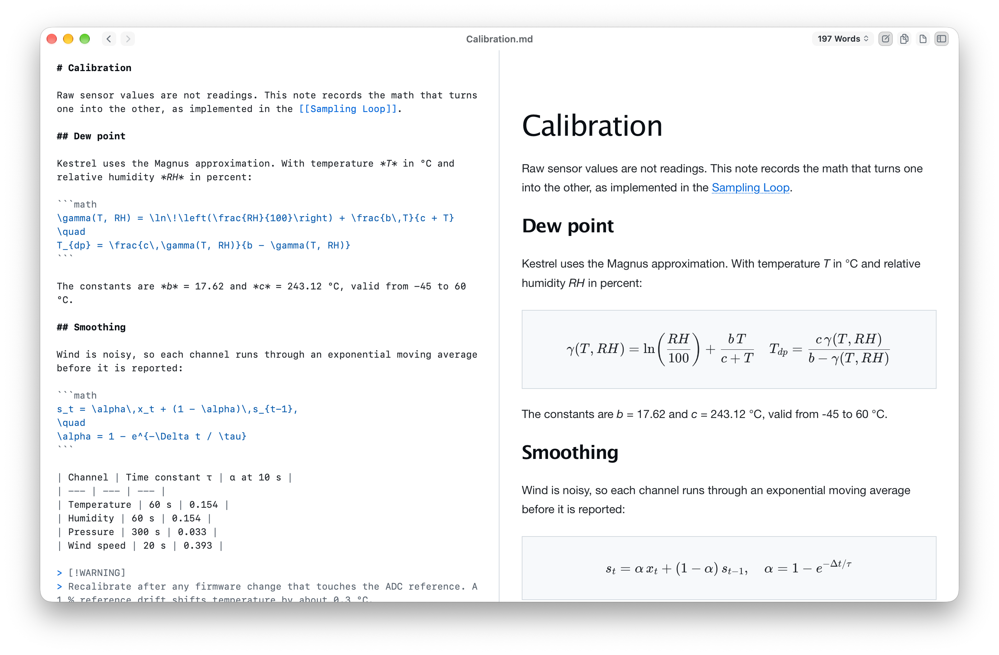
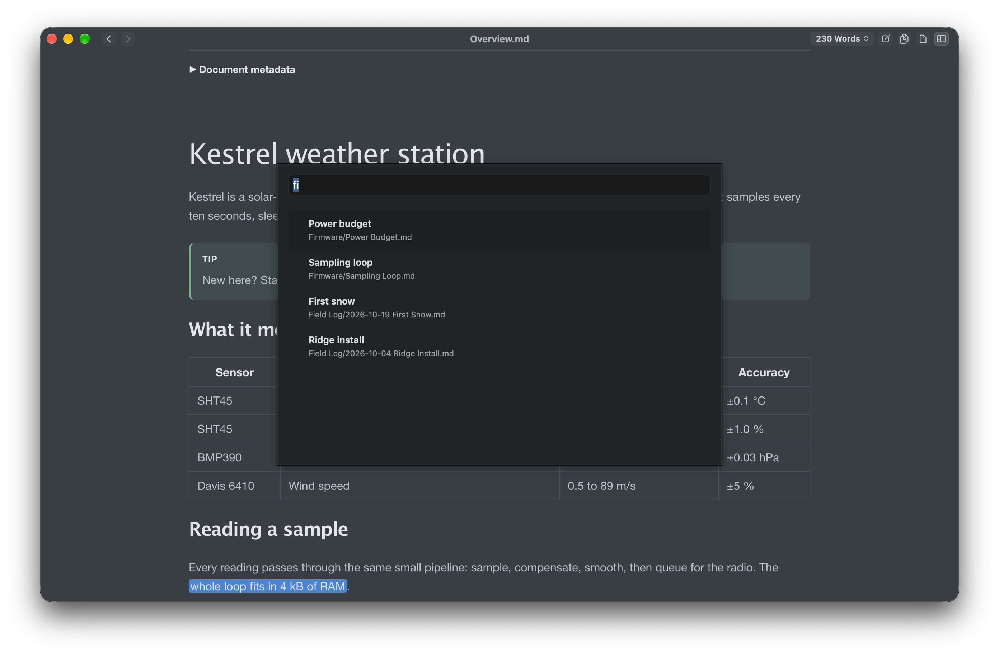
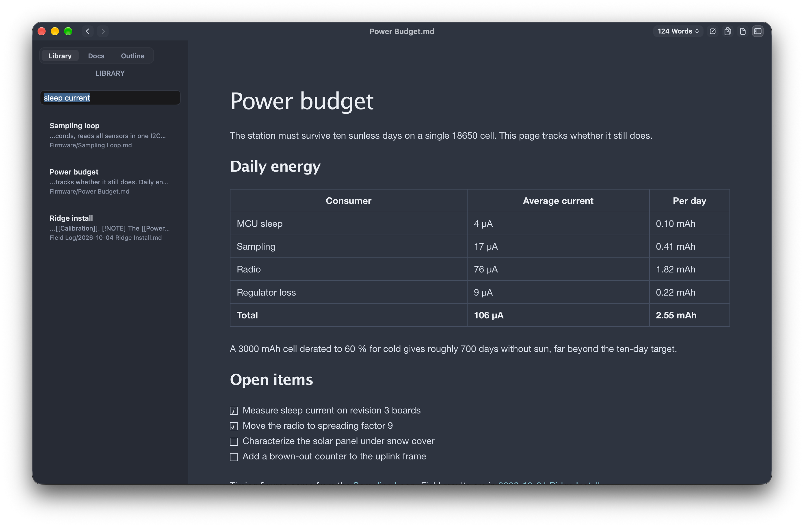
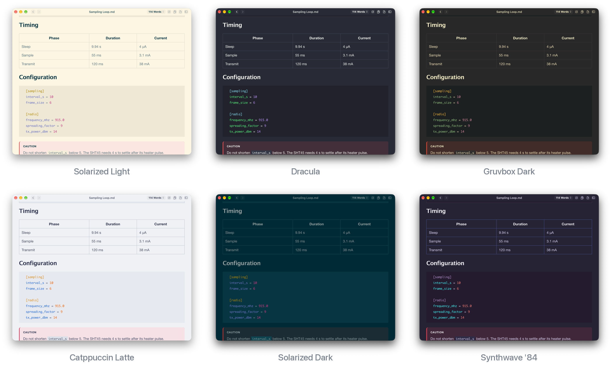
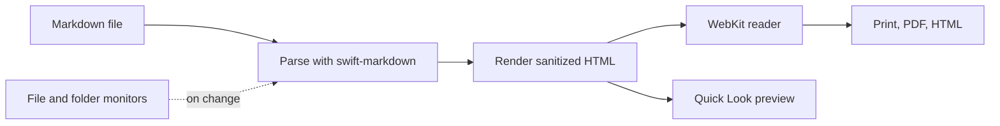

<p align="center">
  
</p>

<h1 align="center">Wafer</h1>

<p align="center">
  A fast, native Markdown reader for macOS, with an editor for when you need one.
</p>

<p align="center">
  <a href="../../releases/latest"><strong>Download for macOS</strong></a>
  <br>
  <sub>macOS 14 or later on Apple silicon</sub>
</p>

<p align="center">
  
</p>

## What it is

Wafer opens Markdown the way Preview opens a PDF: quickly, read-only by default, and rendered the way the author intended. Open one file or a whole folder of notes. Wafer renders GitHub-flavored Markdown, Mermaid diagrams, and math without a network connection, and it follows a file as it changes on disk.

It is made for reading documents that something else writes: READMEs, design docs, note vaults, and files that another editor or a coding agent keeps rewriting. When you want to change something yourself, `Cmd-E` opens the Markdown source beside a live preview.

## Highlights

- **A reader first.** A centered text column, native typography, and a titlebar that blends into the page. The titlebar shows a word, minute, line, or character count and has buttons to copy the Markdown text or the file itself.
- **Live reload.** When the file changes on disk the page updates in place and keeps your scroll position. At the bottom of a growing file, it stays at the bottom.
- **Edit mode.** A syntax-colored source editor slides out next to the reader, which becomes a live preview. The two panes scroll together, and edits save automatically.
- **Folder library.** Open a folder to get a file tree, fuzzy Quick Open, full-text search with heading deep links, tabs, and back and forward history.
- **Wiki links and backlinks.** `[[Note]]`, `[[Note|alias]]`, and `[[Note#Heading]]` resolve across the library, and the outline lists every note that links to the current one.
- **Diagrams and math, offline.** Mermaid and KaTeX are bundled with the app. Nothing is fetched to render them.
- **GitHub-compatible rendering.** Alerts, footnotes, task lists, tables, front matter, emoji shortcodes, autolinks, `==highlights==`, a sanitized HTML subset, and syntax highlighting for more than 30 languages.
- **Themes.** System, Light, and Dark, 14 bundled themes, and your own themes as JSON files.
- **Print and export.** Print, PDF, and standalone HTML output keep the active theme.
- **Quick Look.** Press Space on a Markdown file in Finder to get the same rendering.
- **Private by design.** No analytics. The only network requests are remote `https` images, which you can turn off, and update checks, which ask first and send no system profile.

## A quick tour

### Diagrams, outline, and backlinks

Mermaid fences render as diagrams that follow the theme. The Outline sidebar tracks the section you are reading and ends with a "Linked From" list of the notes that point here.

<p align="center">
  
</p>

### Edit beside a live preview

`Cmd-E` widens the window for the Markdown source. The preview updates as you type and replaces only the blocks that changed, so diagrams and math stay in place. Saving keeps the file's encoding, line endings, and permissions, and Wafer never overwrites a change made by another program without asking.

<p align="center">
  
</p>

### Find anything in a folder

`Cmd-Shift-O` opens files by fuzzy name. `Cmd-Shift-F` searches titles, headings, and body text, and opens a result at the matching section.

| Quick Open | Library search |
| --- | --- |
|  |  |

### Themes

Every theme colors the reader, sidebar, titlebar, code, diagrams, and math together. Switching is instant and keeps your place.

<p align="center">
  
</p>

The bundled themes are GitHub Light, GitHub Dark, Dracula, Solarized Light, Solarized Dark, Nord, Monokai, One Dark, Gruvbox Dark, Catppuccin Mocha, Catppuccin Latte, Tokyo Night, Rosé Pine, and Synthwave '84. To make your own, see [Appearance themes](docs/GUIDE.md#appearance-themes).

## Download

1. Download `Wafer-<version>.zip` from the [latest release](../../releases/latest).
2. Unzip it and move `Wafer.app` into your Applications folder.
3. Open it. Wafer is signed and notarized, so macOS opens it without a security warning.

Wafer needs macOS 14 or later on Apple silicon. New versions arrive through Wafer > Check for Updates..., and nothing is downloaded until you choose to install.

To make Wafer the default for Markdown, select a `.md` file in Finder, choose File > Get Info, pick Wafer under "Open with", and click Change All.

## Keyboard shortcuts

| Shortcut | Action |
| --- | --- |
| `Cmd-O` | Open markdown files |
| `Cmd-Option-O` | Open a folder as the library |
| `Cmd-Shift-O` | Quick Open library file |
| `Cmd-Shift-F` | Search the library |
| `Cmd-F` | Find in the current document |
| `Cmd-G` | Find next match |
| `Shift-Cmd-G` | Find previous match |
| `Cmd-R` | Reload the current document |
| `Cmd-E` | Toggle edit mode (source editor beside the live preview) |
| `Cmd-S` | Save edits now (edit mode saves automatically) |
| `Cmd-Z` / `Cmd-Shift-Z` | Undo / Redo in the editor |
| `Cmd-[` / `Cmd-]` | Back / Forward through in-window navigation history |
| `Cmd-W` | Close the current tab (the window when it is the last tab) |
| `Cmd-Shift-[` / `Cmd-Shift-]` | Show previous / next tab |
| `Ctrl-Tab` / `Ctrl-Shift-Tab` | Cycle tabs |
| `Cmd-Ctrl-←` / `Cmd-Ctrl-→` | Move the current tab |

`Cmd`-click a file in the sidebar or a search result to open it in a new tab.

## How it works

Wafer is a native AppKit app written in Swift. A shared core parses and renders Markdown, the app shows the result in a WebKit view, and a Quick Look extension reuses the same core for Finder previews.



- **Parsing.** Files are parsed off the main thread with [swift-markdown](https://github.com/swiftlang/swift-markdown). A thin compatibility layer adds front matter, footnotes, GitHub alerts, autolinks, emoji shortcodes, highlights, and wiki links.
- **Rendering.** Each document becomes one self-contained HTML page. Raw HTML passes through an allowlist sanitizer, and every page carries a Content Security Policy that blocks network access and unknown scripts.
- **Images.** Local images load only from the document's folder. Remote images load only over `https`, with no cookies and no cache.
- **Diagrams and math.** Mermaid 11.14.0 and KaTeX 0.17.0 ship inside the app and run only in documents that use them.
- **Staying current.** A file monitor re-renders the document when it changes and restores the scroll position. Edits and theme changes patch the existing page instead of reloading it, so the view does not flash or lose its place.
- **Library.** Opening a folder indexes up to 2,000 Markdown files in the background. One index serves the file tree, Quick Open, search, wiki links, and backlinks.
- **Quick Look.** The preview extension is sandboxed, runs no scripts, and makes no network requests.

[ARCHITECTURE.md](ARCHITECTURE.md) covers the design in depth, including the security model.

## Documentation

- [User guide](docs/GUIDE.md): edit mode, the folder library, tabs and history, wiki links, export, Quick Look, custom themes, and the supported HTML subset.
- [Architecture](ARCHITECTURE.md): modules, rendering pipeline, edit mode internals, and the security model.
- [Development](docs/DEVELOPMENT.md): building, testing, repository layout, and the release checklist.
- [In-app updates](docs/UPDATES.md): how releases and the update feed are published.

## Build from source

You need macOS 14 or later and Swift 6.2.3 or later (Xcode 26.3 or a matching toolchain). The checks also require Python 3 and Node.js 22 or later. Wafer and the pinned swift-markdown dependency both require Swift tools 6.2.

```sh
scripts/check.sh
scripts/build-app.sh release
open build/Wafer.app
```

`scripts/check.sh --release` tests optimized Core and Quick Look code. `scripts/check.sh --perf` enables the optional performance assertions; the options can be combined. Release builds retain matching dSYMs in `build` and strip the shipping executables before signing. Release packaging requires committed source and a notarytool Keychain profile.

A source build uses the sandboxed `dev.wafer.app.dev` identity, with separate preferences and no migration of release data or release update feed. It is signed ad hoc. Only release packaging selects `dev.wafer.app` explicitly. The screenshots on this page use the small vault in [`docs/demo`](docs/demo); open it with File > Open Folder... to try the library, wiki links, diagrams, and math. See [Development](docs/DEVELOPMENT.md) for tests and packaging.

## License

Copyright (C) 2026 Wafer contributors.

Wafer is free software under the [GNU Affero General Public License, version 3](LICENSE) (`AGPL-3.0-only`). You can use it for any purpose, study it, change it, and share it. If you distribute Wafer or a program built from its code, or offer one to users over a network, you must release your complete source code under the same license.

**Commercial licenses.** To use Wafer's code in a product without releasing your own source, you need a commercial license. Open an issue in this repository to ask for one.

**Contributions.** Contributions are accepted under the same two sets of terms. By opening a pull request you agree that your contribution may be distributed under the AGPL and under commercial licenses for Wafer.

## Credits

Wafer is built on these open-source projects. Each one stays under its own license.

| Project | Copyright | License | Used for |
| --- | --- | --- | --- |
| [swift-markdown](https://github.com/swiftlang/swift-markdown) | Apple Inc. and the Swift project authors | Apache-2.0 | Markdown parsing |
| [swift-cmark](https://github.com/swiftlang/swift-cmark) (cmark-gfm) | John MacFarlane, GitHub, Inc., and contributors | BSD-2-Clause, with MIT-licensed parts | Markdown parsing, through swift-markdown |
| [Sparkle](https://github.com/sparkle-project/Sparkle) | Andy Matuschak and the Sparkle project | MIT, with BSD-2-Clause and zlib-style parts | In-app updates |
| [Mermaid](https://github.com/mermaid-js/mermaid) | Knut Sveidqvist and contributors | MIT | Diagrams |
| [KaTeX](https://github.com/KaTeX/KaTeX) and its fonts | Khan Academy and contributors | MIT | Math |
| [gemoji](https://github.com/github/gemoji) | GitHub, Inc. | MIT | Emoji shortcode names |

The Mermaid build includes about 75 more libraries, among them [D3](https://github.com/d3/d3) (ISC and BSD-3-Clause), [DOMPurify](https://github.com/cure53/DOMPurify) (Apache-2.0 or MPL-2.0), [Cytoscape.js](https://github.com/cytoscape/cytoscape.js), [dagre-d3-es](https://github.com/tbo47/dagre-es), [Langium](https://github.com/eclipse-langium/langium), [Chevrotain](https://github.com/Chevrotain/chevrotain) (Apache-2.0), [lodash](https://github.com/lodash/lodash), [marked](https://github.com/markedjs/marked), [js-yaml](https://github.com/nodeca/js-yaml), and [Rough.js](https://github.com/rough-stuff/rough).

[THIRD_PARTY_NOTICES.md](THIRD_PARTY_NOTICES.md) lists every bundled component and reproduces its copyright notice and license text in full. The same file ships in the app at `Wafer.app/Contents/Resources/THIRD_PARTY_NOTICES.md`. Mermaid, KaTeX, and gemoji also keep their original license files beside their resources.

The bundled themes use color palettes from their original projects: [GitHub Primer](https://primer.style), [Dracula](https://draculatheme.com), [Solarized](https://ethanschoonover.com/solarized/), [Nord](https://www.nordtheme.com), Monokai, [One Dark](https://github.com/atom/atom/tree/master/packages/one-dark-syntax), [Gruvbox](https://github.com/morhetz/gruvbox), [Catppuccin](https://catppuccin.com), [Tokyo Night](https://github.com/enkia/tokyo-night-vscode-theme), [Rosé Pine](https://rosepinetheme.com), and [Synthwave '84](https://github.com/robb0wen/synthwave-vscode). Wafer's theme files contain only colors and are not copied from those projects.
