# Wafer Rendering Showcase

Open this file in Wafer to preview the current reader surface. It is meant to exercise readable width, spacing, lists, tables, code blocks, images, links, the supported HTML subset, and fallback styling in a single document.

This file starts with YAML front matter on purpose. It should render as a collapsed metadata panel above the document body instead of becoming a thematic break or a giant heading.

While reading, switch between themes in the Theme menu (System, Light, Dark, the bundled themes, and any custom themes) and confirm every section below re-colors together: text, callouts, code highlighting, diagrams, math, and chrome.

Quick links:
- External link: [swift-markdown](https://github.com/swiftlang/swift-markdown)
- Local markdown link: [Linked Note](LinkedNote.md)
- Same-document anchor: [Jump to Heading Ladder](#heading-ladder)
- Same-document deep anchor: [Jump to Tables](#tables)
- GitHub-style anchor alias: [Jump to What's New](#whats-new)
- Math section: [Jump to Math Fences](#math-fences)
- HTML subset: [Jump to Supported HTML Subset](#supported-html-subset)
- Local non-markdown link: [License](LICENSE)

## Heading Ladder

# Level 1 Heading

## Level 2 Heading

### Level 3 Heading

#### Level 4 Heading

##### Level 5 Heading

###### Level 6 Heading

## What's New?

This heading deliberately contains punctuation so GitHub-authored links using `#whats-new` still land here without changing Wafer's primary outline anchor.

## Paragraph Rhythm

The goal of this pass is a calmer reader surface: a centered column, native typography, clearer hierarchy, and enough spacing to make dense markdown easier to scan without feeling like a web page inside a wrapper.

This second paragraph exists mostly to make line height, paragraph spacing, and column width obvious. Resize the window narrower and wider to see how the content reflows while staying inside a readable text measure.

## Inline Styling

Plain text should feel neutral. `Inline code` should read like a soft utility chip instead of a selected region. You should also see **strong emphasis**, *emphasis*, ***combined emphasis***, and ~~strikethrough~~ render distinctly without feeling heavy.

You can also mix styles in one sentence: **bold text with `inline code` inside it** and a link to [Apple](https://www.apple.com).

Bare autolinks should become clickable in reader, preview, and export: https://example.com/wafer, www.example.org/docs, and support@example.com. Trailing punctuation should stay outside the link, like https://example.com/releases.

Already-linked URLs should not double-link, like [https://example.com/already-linked](https://example.com/already-linked), and inline code like `https://example.com/not-linked` should stay code.

Emoji shortcodes should render as Unicode where known, like :rocket: and :sparkles:, while unknown values like :wafer_unknown: stay literal. Code spans like `:rocket:` should stay raw. Highlight pairs should render as ==themed mark text==, while unmatched markers like ==this stay literal and triple markers like ===this also stays literal===.

Wiki links like [[Another Note]] and [[Another Note|an alias]] render as muted unresolved spans outside a library, while a same-document [[#Callouts]] link resolves locally. Footnotes should render as numbered notes with backlinks while missing definitions like [^missing-note] stay literal.[^rendering-note] A second note checks continuation indentation.[^continued-note] Inline code like `[^rendering-note]` should remain code.

[^rendering-note]: Footnote definitions can contain **formatting** and [links](https://example.com/footnotes).

[^continued-note]: The first paragraph belongs to the second footnote.
    This indented continuation paragraph should stay inside the same footnote.

## Callouts

@Note {
This note should render as a calm native callout with ordinary markdown inside it, including **bold text** and a [same-document anchor](#tables).
}

@Tip {
Symbol links should read in code voice, like ``ReaderTheme.styleSheet`` and ``MarkdownParser.parse(source:baseURL:)``.
}

@Important {
Important callouts get their own accent, sitting between an informational note and a warning. They should hold ordinary markdown like `inline code` and [links](LinkedNote.md).
}

@Warning(title: "Use a gentle warning tone") {
Warnings should stay restrained. This one includes `inline code`, *emphasis*, and ^[chip text](class: "md-inline-chip").
}

@Caution {
Caution is the strongest tone in the set. All five kinds (note, tip, important, warning, caution) plus the `info` alias for note should each render with a distinct border and tinted background.
}

## GitHub Alerts

> [!NOTE]
> GitHub note alerts map onto the same themed callout surface as directive notes.

> [!TIP]
> Tip alerts keep ordinary markdown like **bold text** and [links](#tables).

> [!IMPORTANT]
> Important alerts should feel related to directive important callouts.

> [!WARNING]
> Warning alerts use the existing warning tone.

> [!CAUTION]
> Caution alerts use the strongest callout tone without showing the `[!CAUTION]` marker.

> [!NOTE] extra words on the marker line
> This should stay a normal blockquote because GitHub alert markers only convert when the marker is alone on its line.

## Inline Attribute Spans

Inline attribute spans should preserve only `class`: ^[chip text](class: "md-inline-chip") and ^[muted helper text](class: "md-inline-muted", demo: "ignored").

## Blockquote

> Wafer should feel like a quiet native document reader, not a browser tab pretending to be a Mac app.
>
> This quote includes `inline code` and an [external link](https://developer.apple.com/documentation/foundation/nsattributedstring) so you can verify that nested styling still holds together inside the quote block.

## Lists

- Top-level bullet item
- Bullet item with enough copy to wrap onto another line so the hanging indent is visible and the marker column stays separate from the body text.
  - Nested bullet item
  - Nested bullet item with `inline code`
  - Nested bullet item with a [markdown link](LinkedNote.md)
- Another top-level bullet item

1. Ordered item one
2. Ordered item two with a slightly longer sentence to show how wrapped lines align after the marker.
3. Ordered item three
   - Nested unordered item
   - Another nested unordered item

<ol start="4">
  <li>HTML ordered item starting at four</li>
  <li>Second item keeps the supplied start number</li>
</ol>

## Task Lists

- [x] Completed task item
- [ ] Pending task item
- [x] A longer completed task that should wrap and still keep the checkbox aligned against the text body instead of drifting into the paragraph.

## Code Blocks

### Swift

```swift
struct ReaderTheme {
    let readableWidth: Double
    let outerGutter: Double
    let bodyLineSpacing: Double
}

let longLine = "This intentionally long line exists to check that fenced code wraps inside the reading column instead of forcing an ugly horizontal reading experience."

func render(_ markdown: String) -> String {
    markdown.trimmingCharacters(in: .whitespacesAndNewlines)
}
```

### Bash

```bash
./scripts/build-app.sh release
open build/Wafer.app
```

### JSON

```json
{
  "name": "Wafer",
  "version": 1,
  "features": {
    "reader": true,
    "syntaxHighlighting": true
  }
}
```

### YAML

```yaml
app:
  name: "Wafer"
  window_width: 1040
  syntax:
    enabled: true
    theme: dark
```

### Markdown

```markdown
# Release Notes

- Added broader fenced-code highlighting
- Improved local window reuse
- Kept fallback HTML visible
```

### HTML

```html
<!DOCTYPE html>
<article class="card">
  <h1 data-title="Wafer">Reader</h1>
  <p>Calm, local-first markdown reading.</p>
</article>
```

### CSS

```css
@media (min-width: 900px) {
  .card {
    color: #fff;
    transform: translateX(12px);
  }
}
```

### SCSS

```scss
$accent: #7aa2f7;

.card {
  color: $accent;
  &:hover {
    filter: brightness(1.2);
  }
}
```

### XML

```xml
<?xml version="1.0" encoding="UTF-8"?>
<reader theme="dark">
  <document path="RenderingShowcase.md" />
</reader>
```

### TOML

```toml
[app]
name = "Wafer"
sidebar_open = false

[reader]
theme = "dark"
smooth_sidebar = true
```

### Go

```go
package main

type Reader struct {
    Title string
}

func renderCard(reader Reader) string {
    return reader.Title
}
```

### Ruby

```ruby
class Reader
  def render_card
    @title = "Wafer"
  end
end
```

### Python

```python
class Reader:
    @property
    def title(self):
        return self._title
```

### Elixir

```elixir
defmodule Reader do
  def render_card(reader) do
    reader.title
  end
end
```

### JavaScript

```javascript
class Reader {}

const renderCard = (props) => props.title;
```

### TypeScript

```typescript
interface Props {
  title: string;
}

const renderCard = (props: Props) => props.title;
```

### PHP

```php
<?php

class Reader {
    public function renderCard(): string {
        return $this->title;
    }
}
```

### C

```c
#include <stdio.h>

int render_card(struct reader *value) {
    return value->title[0];
}
```

### C++

```cpp
#include <string>

class Reader {};

std::string render_card(Reader* value) {
    return value->title;
}
```

### Rust

```rust
#[derive(Debug)]
struct Reader {
    title: String,
}

fn render_card(reader: Reader) -> String {
    reader.title
}
```

### Zig

```zig
const Reader = struct {
    title: []const u8,
};

fn renderCard(reader: Reader) []const u8 {
    return reader.title;
}
```

### Haskell

```haskell
{-# LANGUAGE OverloadedStrings #-}

data Reader = Reader

renderCard reader = reader
```

### Java

```java
class Reader {
    String renderCard(Reader value) {
        return value.title;
    }
}
```

### Diff

```diff
diff --git a/ReaderTheme.swift b/ReaderTheme.swift
index 1234567..89abcde 100644
--- a/ReaderTheme.swift
+++ b/ReaderTheme.swift
@@ -1,4 +1,4 @@
-let titlebarFlat = false
+let titlebarFlat = true
```

### Dockerfile

```dockerfile
FROM swift:6.1 AS build
WORKDIR /src
COPY . .
RUN swift test
```

### SQL

```sql
SELECT title, count(*) FROM posts WHERE status = 'published';
```

### Kotlin

```kotlin
data class Reader(val title: String)

fun render(reader: Reader): String {
    return reader.title
}
```

### C#

```csharp
public sealed record Reader(string Title);

public static string Render(Reader reader) {
    return reader.Title;
}
```

### Objective-C

```objective-c
@interface Reader : NSObject
@property (nonatomic, copy) NSString *title;
@end
```

### Lua

```lua
local reader = { title = "Wafer" }

function reader:render()
  return self.title
end
```

### INI

```ini
[reader]
theme = dark
reload = true
```

### GraphQL

```graphql
query ReaderDocument($id: ID!) {
  document(id: $id) {
    title
    outline {
      level
      text
    }
  }
}
```

### HCL

```hcl
resource "wafer_theme" "dark" {
  name   = "Dark"
  accent = "#7aa2f7"
}
```

### Protobuf

```protobuf
syntax = "proto3";

message ReaderDocument {
  string title = 1;
  repeated string headings = 2;
}
```

### Makefile

```makefile
VERSION = 1.0.0
build:
	@echo $(VERSION)
```

## Math Fences

Math fences should render offline through bundled KaTeX in the reader and exported DOM. Switch between Light, Dark, and one bundled theme and confirm the expression inherits the document text color.

```math
c = \pm\sqrt{a^2 + b^2}
```

Only fenced `math` blocks are interpreted as math. Inline dollar math like `$E = mc^2$` stays literal to avoid false positives in ordinary prose.

Invalid TeX should show the original source in red instead of leaving a blank area:

```math
\definitelynotacommand{
```

## Mermaid Diagrams

Mermaid fences should render offline as SVG diagrams instead of code blocks. Hover over any rendered diagram and an `Open` control appears in its corner; it opens the diagram inspector with zoom, pan, fit, reset, and copy-SVG controls, and `Esc` closes it back to the same reading position.

### Flowchart

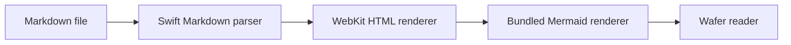

### Pie Chart

```mmd
pie title Reader Surface
    "Text" : 45
    "Code" : 30
    "Diagrams" : 25
```

### Sequence Diagram

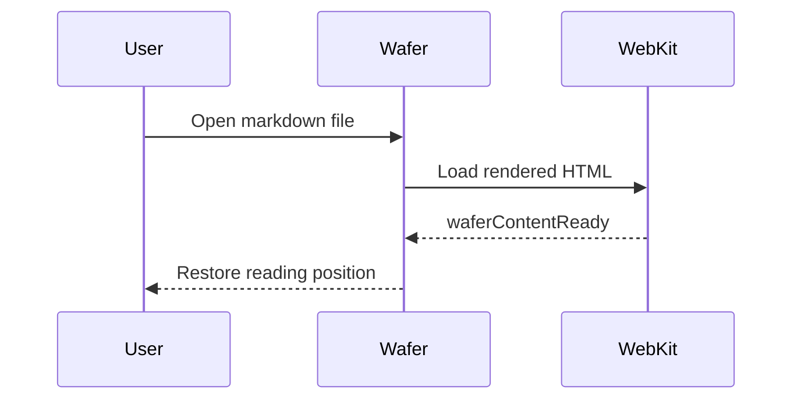

### Gantt

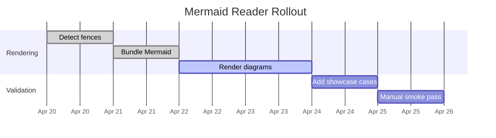

### Entity Relationship Diagram

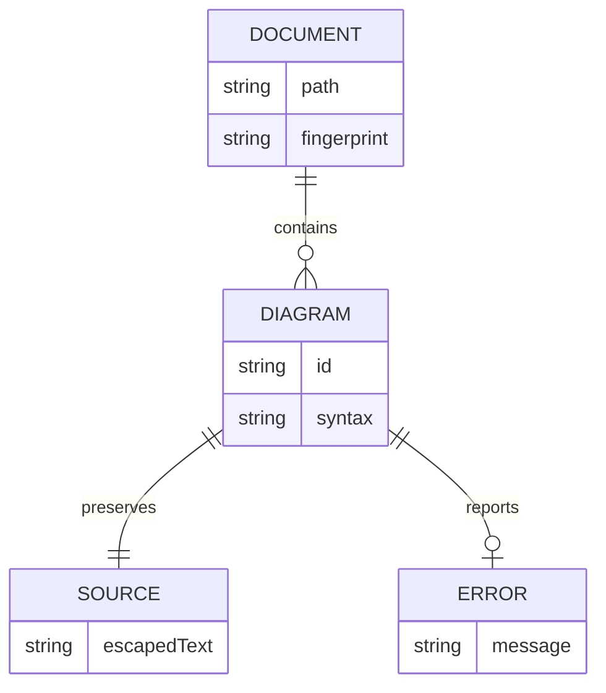

### State Diagram

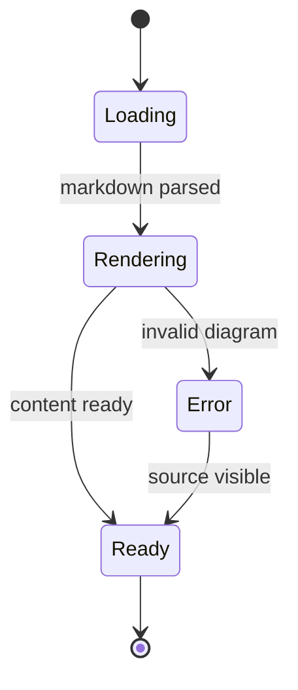

### Git Graph

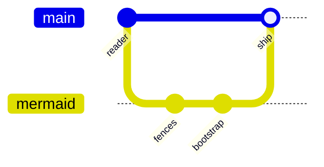

### Class Diagram

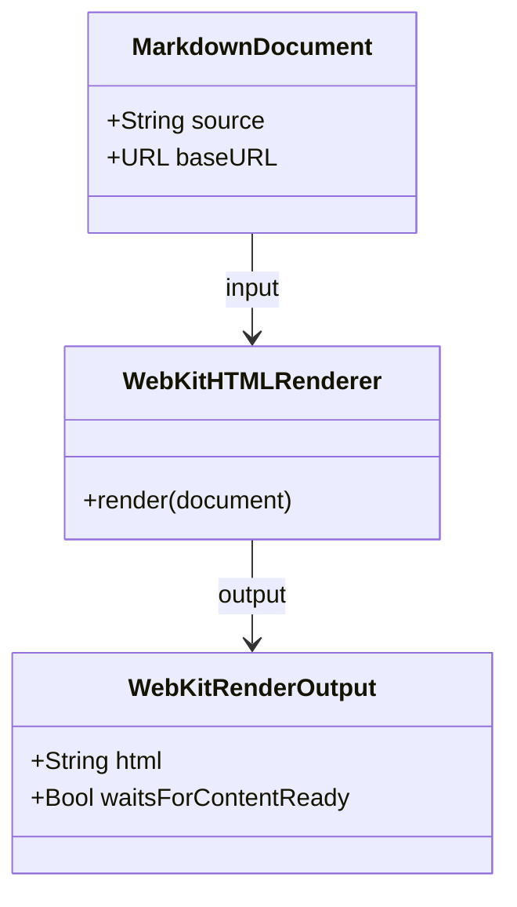

### Quadrant Chart

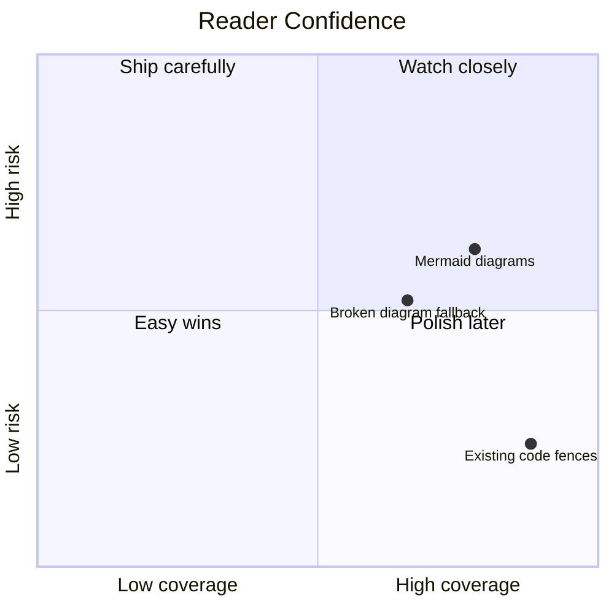

### XY Chart

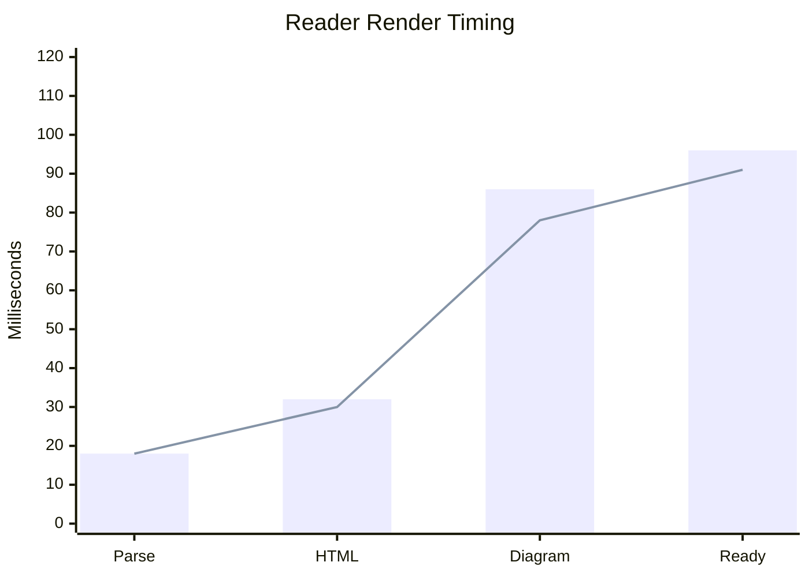

### Sankey

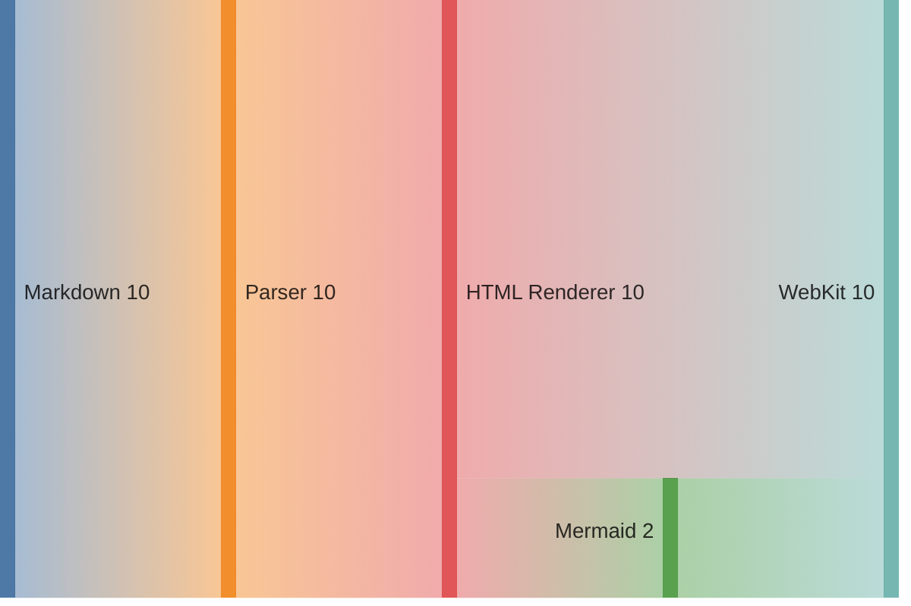

### Timeline

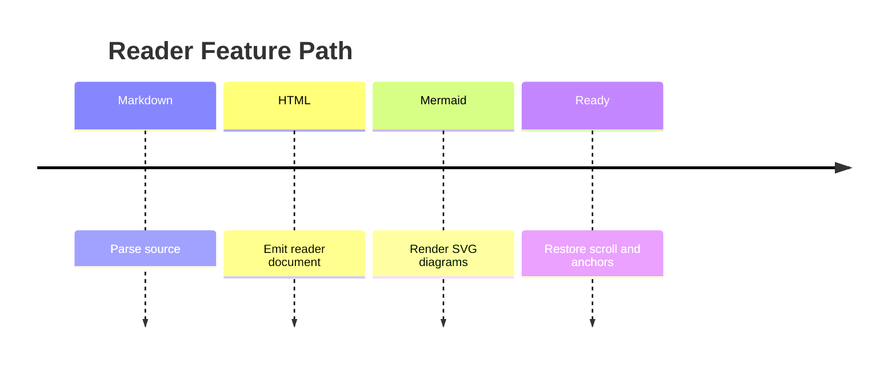

## Tables

| Surface | Current Treatment | What To Look For | Score |
| --- | --- | --- | ---: |
| Paragraphs | Native text layout | Comfortable rhythm and readable width | 9 |
| Headings | Strong hierarchy | Distinct scale without giant spacing cliffs | 9 |
| Inline code | `Soft chip styling` | Monospaced text with restrained contrast | 8 |
| Code blocks | Native text blocks | Padded container, calmer border, wrapped lines | 8 |
| Blockquotes | Left rule and **soft fill** | Separation without looking like a callout card | 8 |
| Tables | Native text tables with [same-file anchors](#heading-ladder) | Real cells, subtle borders, alternating rows, and inline markdown rendering | 8 |

| Markdown In Cells | Example Content | Expected Rendering |
| --- | --- | --- |
| Strong + code | **Bold text** with `inline code` | Both should render, not show raw markdown |
| Mixed inline | *Emphasis*, ~~strikethrough~~, and [local link](LinkedNote.md) | Inline styles and links should all work inside cells |
| Same-document anchor | [Back to top section](#wafer-rendering-showcase) | Clicking should scroll in this window, not open a new one |

## Images

The app should load this local image asynchronously after the first text paint:


Remote images load only from `https` URLs, and only while File > Load Remote Images is enabled. With it disabled, the image below should simply not appear; with it enabled, reload with Cmd-R and it should render:


## Supported HTML Subset

The reader renders a sanitized subset of inline HTML natively instead of falling back.

<h3>HTML heading sample</h3>

Keyboard keys render as themed key caps: press <kbd>Cmd</kbd> + <kbd>O</kbd> to open another file, or <kbd>Esc</kbd> to close the diagram inspector.

Inline elements: <mark>highlighted text</mark>, <ins>inserted text</ins>, <del>deleted text</del>, <small>small text</small>, <u>underlined text</u>, <q>quoted text</q>, <cite>cited text</cite>, <time datetime="2026-07-08">July 8, 2026</time>, H<sub>2</sub>O and E = mc<sup>2</sup>, plus an <abbr title="Abbreviation titles surface on hover">abbr</abbr> element with a hover title and a soft break<wbr>opportunity.

<blockquote>
  <p>This raw HTML blockquote should survive sanitization instead of becoming fallback text.</p>
</blockquote>

<details>
<summary>Disclosure with details and summary</summary>

The content inside a details element should stay hidden until expanded, and ordinary markdown text inside it should still read comfortably.

</details>

An HTML table with alignment and a spanned cell:

<table>
  <caption>Sanitized table caption</caption>
  <colgroup>
    <col span="1">
    <col span="1">
  </colgroup>
  <thead>
    <tr><th align="left">Feature</th><th align="right">Status</th></tr>
  </thead>
  <tbody>
    <tr><td align="left">Sanitized HTML subset</td><td align="right">Supported</td></tr>
    <tr><td colspan="2" align="center">Cells can span columns</td></tr>
  </tbody>
  <tfoot>
    <tr><td align="left">Footer row</td><td align="right">Still visible</td></tr>
  </tfoot>
</table>

An HTML image with an explicit width should resolve through the same local asset pipeline as markdown images:


HTML lists, figures, definitions, and picture sources should survive sanitization:

<ul>
  <li>Raw HTML unordered list item</li>
</ul>

<figure>
  
  <figcaption>Figure caption rendered from sanitized HTML.</figcaption>
</figure>

<dl>
  <dt>Definition term</dt>
  <dd>Definition details.</dd>
</dl>

<picture>
  <source media="(prefers-color-scheme: dark)" type="image/png" srcset="App/Resources/Wafer-preview.png 1x">
  
</picture>

## Thematic Break

The section below is separated by a thematic break so you can judge how subtle or strong the rule feels.

---

## Fallback Styling

Raw HTML block fallback:

<aside>
This HTML block is intentionally unsupported in the reader and should degrade into a calm styled fallback block instead of disappearing or looking broken.
</aside>

Block directive fallback:

@Legacy(kind: "unstyled") {
This unsupported directive should still degrade into a styled fallback block.
}

Invalid Mermaid diagrams should show a calm inline error with the original source preserved below it instead of a blank gap:

```mermaid
flowchart LR
    This is not valid mermaid syntax -->
```

## Scroll Check

If you can scroll smoothly from here back to the top, the centered-column layout, text sizing, and content height calculation are all behaving correctly.

This last section is only here to make the document a bit taller. Native document readers feel much better when they are tested with enough content to expose layout, scrolling, and reflow behavior rather than a tiny README-sized snippet.
