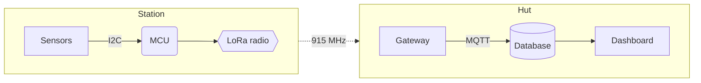
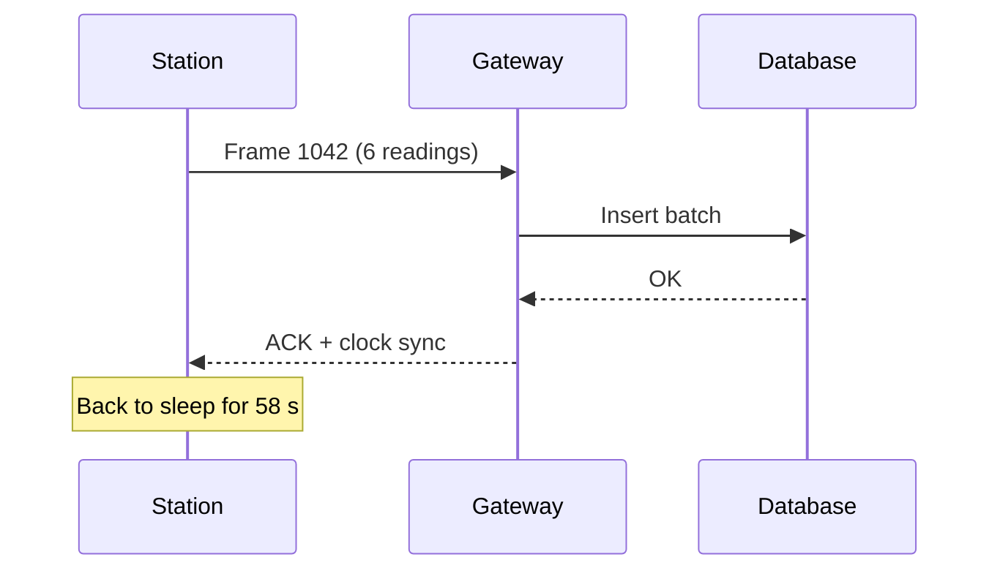

# Architecture

A reading takes four hops from the sensor to a chart. Each hop can fail on its own, so every stage buffers what it cannot yet deliver.

## Data flow

## Uplink sequence

## Design rules

1. **Never block on the radio.** Frames queue in flash until the gateway acknowledges them.
2. **Compensate on the device.** Raw values never leave the station, so every consumer sees the same numbers. See [[Calibration]].
3. **Sleep is the default state.** The [[Power Budget]] only works if the MCU is awake less than 2 % of the time.

> [!IMPORTANT]
> The gateway is the only component with a network connection. Stations are radio-only by design.

Back to the [[Overview]].
