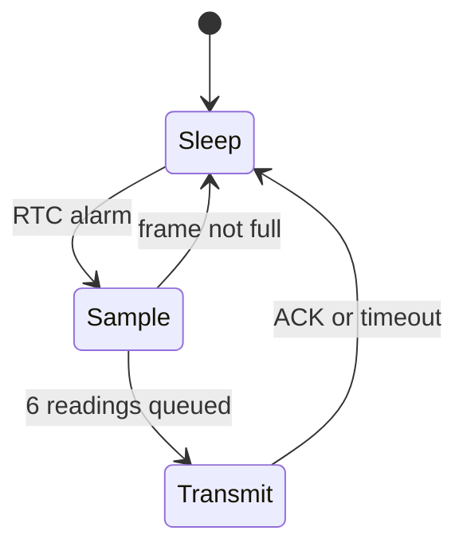

# Sampling loop

The loop wakes every ten seconds, reads all sensors in one I2C burst, and goes back to sleep. Everything else is bookkeeping.

## States



## Timing

| Phase | Duration | Current |
| --- | --- | --- |
| Sleep | 9.94 s | 4 µA |
| Sample | 55 ms | 3.1 mA |
| Transmit | 120 ms | 38 mA |

## Configuration

```toml
[sampling]
interval_s = 10
frame_size = 6

[radio]
frequency_mhz = 915.0
spreading_factor = 9
tx_power_dbm = 14
```

> [!CAUTION]
> Do not shorten `interval_s` below 5. The SHT45 needs 4 s to settle after its heater pulse.

The filter math lives in [[Calibration]]. The energy cost of each phase is tallied in [[Power Budget]].
